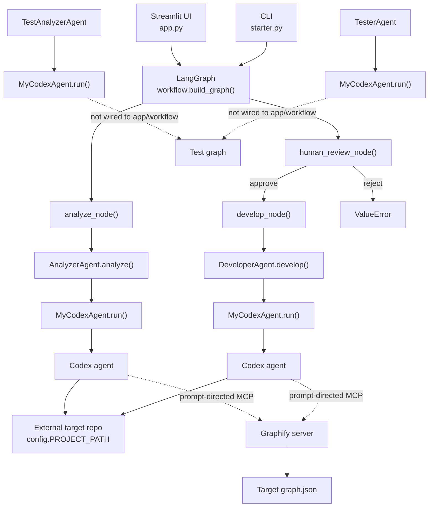
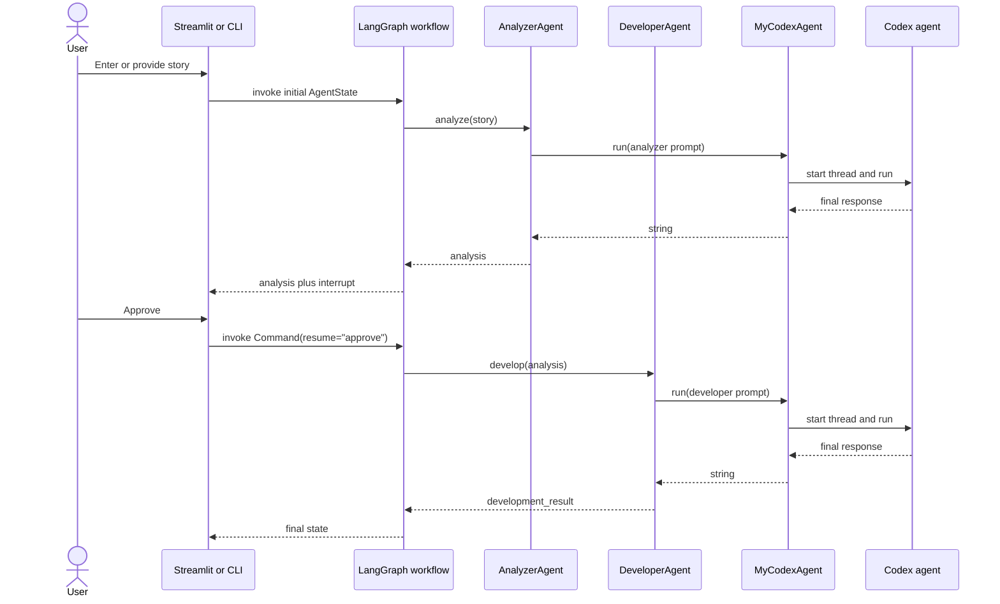

# Architect.md

> Architecture of the code currently present in this working tree, inspected on 2026-10-27.
> Statements marked **Verified** come from source/configuration inspection. **Inferred** statements are reasonable conclusions not directly asserted by code. **Unknown** items could not be established from this repository.

## 1. Project Overview

**Verified.** This repository is a small proof-of-concept for an AI-assisted software-development workflow. A user supplies a development story; an analyzer agent examines a separate target repository, a human approves or rejects the analysis, and a developer agent is asked to implement the approved work. A separate test-analysis/tester pipeline exists in source but is not connected to the main workflow.

The application is not a settlement system. The checked-in files under `docs/md/settle/` describe a separate Java settlement project and are prompt context for the analyzer/developer agents, not documentation of this Python repository.

Main capabilities present in source:

- A Streamlit UI and a CLI entry point.
- A three-node LangGraph workflow: analyzer, human review, developer.
- Human-in-the-loop interruption and approval.
- Reusable configuration for invoking the Codex coding agent.
- Graphify MCP server registration for the external target and test repositories.
- Prompt-driven analyzer, developer, test-analyzer, and tester roles.

The implemented style is an **in-process, script-oriented orchestration prototype**. The Streamlit/CLI process owns the LangGraph state machine and delegates work over an SDK/CLI boundary to Codex. There is no application server, database, message broker, repository layer, or independently deployed service in this repository.

Primary technologies:

- Python 3.14 in the local `.venv`.
- Streamlit for the UI.
- LangGraph for workflow state and interruption.
- LangChain packages, although the main workflow does not use the module containing `ChatOpenAI`.
- `openai-codex` for invoking Codex.
- Graphify via the Graphify MCP server command generated by `MyCodexAgent`.

## 2. High-Level Architecture

**Verified.** The active runtime path is:

Architectural boundaries:

- **This repository** owns UI/CLI presentation, the LangGraph state machine, prompts, and Codex configuration.
- **External `PROJECT_PATH`** is the repository analyzed and modified by the agents.
- **External test project** is the tester target.
- **Codex** performs the actual repository investigation and editing.
- **Graphify MCP** supplies codebase-navigation tools; the default agent prompts direct Codex to call Graphify before source inspection.
- Dependency direction is from entry points to `workflow.py`, then to agent wrappers, then to `myCodexAgent.py`, `config.py`, and external tools. The external target does not import code from this repository.

## 3. Project Structure

The active project is flat; there are no Python packages or multiple application modules.

| Location | Responsibility |
|---|---|
| `app.py` | Streamlit UI, session setup, workflow invocation, interrupt display, approve/reject controls. |
| `starter.py` | Interactive CLI with a hard-coded sample story and textual approval prompt. |
| `workflow.py` | The authoritative LangGraph graph, state schema, nodes, edges, checkpointer, and agent singleton instances. |
| `analyzerAgent.py` | Builds the analyzer prompt, loads agent/architecture documentation, and calls `MyCodexAgent`. |
| `developerAgent.py` | Builds the developer prompt, loads developer/architecture documentation, and calls `MyCodexAgent`. |
| `myCodexAgent.py` | Shared Codex adapter: configuration value objects, path validation, MCP registration, execution, and telemetry extraction. |
| `config.py` | Hard-coded project paths, documentation paths, Graphify names, Codex executable path, and model/provider values. |
| `testAnalyzerAgent.py` | A separate test-analysis prompt wrapper; not part of the LangGraph graph. |
| `testAgent.py` | A separate tester prompt wrapper; not part of the LangGraph graph. |
| `requirements.txt` | Five unpinned direct dependencies. |
| `docs/md/settle/` | Prompt documents describing a separate Java settlement system. |
| `llm.py` | Unused `ChatOpenAI` instance configured with a placeholder credential. |
| `developer.py`, `state.py`, `developer_tool.py` | Older/unwired workflow path. `developer_tool.py` imports configuration names that `config.py` no longer defines. |
| `.venv/`, `.venv-oracle-test/`, `.idea/`, `__pycache__/` | Local environment/editor/generated content, not application architecture. |

At inspection time, Git also reports unstaged deletions for several tracked legacy scripts (`analyzer_agent.py`, `analyzer_tools.py`, `codex_test.py`, `developer_agent.py`, `graphiphy_test.py`, `main.py`, `main2.py`). They are not present in the working tree and are not described here as active components.

## 4. Core Components

### `workflow.py`

**Responsibility:** Defines and compiles the active workflow.

- `AgentState` is a required-key `TypedDict` with `story`, `analysis`, and `development_result`.
- `analyze_node()` calls the module-level `AnalyzerAgent.analyze(state["story"])` and returns `{"analysis": ...}`.
- `human_review_node()` calls LangGraph `interrupt()` and accepts only `"approve"` or `"reject"`. Approval returns an empty state update; rejection raises `ValueError`; any other value raises `ValueError`.
- `develop_node()` calls the module-level `DeveloperAgent.develop(state["analysis"])` and returns `{"development_result": ...}`.
- `build_graph()` wires `START -> analyzer -> human_review -> developer -> END`, compiles with an in-memory `MemorySaver`, and returns the compiled graph.
- Module import instantiates both agents. Consequently, importing `workflow.py` validates the external repository, Codex binary, Python executable, and Graphify graph paths before the graph is built.

Consumers: `app.py` and `starter.py`.

### `AnalyzerAgent`

**Responsibility:** Ask Codex to investigate the external target and produce a technical analysis for the story.

- Public interface: `AnalyzerAgent.analyze(story: str) -> str`.
- Dependencies: `MyCodexAgent`, `config.py`, and two UTF-8 documents: `docs/md/settle/ANALYZER_AGENTS.md` and `docs/md/settle/ARCHITECTURE.md`.
- The architecture path is hard-coded as an absolute Windows path in `analyze()`, while the imported `ARCHITECT_MD` constant is not used there.
- The prompt requires Graphify investigation before source inspection and requests a structured analysis.
- Consumer: `analyze_node()` in `workflow.py`.

### `DeveloperAgent`

**Responsibility:** Ask Codex to implement the approved analysis.

- Public interface: `DeveloperAgent.develop(analysis: str) -> str`.
- Dependencies: `MyCodexAgent`, `config.py`, `docs/md/settle/DEVELOPER_AGENTS.md`, and `docs/md/settle/ARCHITECTURE.md`.
- It validates that the analysis is nonblank, injects both documents and the analysis into a prompt, then calls `MyCodexAgent.run()`.
- It does not pass the original story separately; implementation context comes through the analysis.
- Consumer: `develop_node()` in `workflow.py`.

### `MyCodexAgent` and configuration value objects

**Responsibility:** Shared adapter to the Codex SDK/CLI and Graphify MCP configuration.

- `GraphifyServerConfig` contains `name`, `graph_path`, and `python`.
- `CodexAgentConfig` contains `repo`, `codex_bin`, `model`, `model_provider`, and a tuple of Graphify servers.
- `MyCodexAgent._validate()` checks that the target repository, Codex executable, nonempty model/provider, Graphify graph file, and Graphify Python executable exist.
- `MyCodexAgent._build_config_overrides()` passes model/provider overrides to Codex and registers each graph with command `<python> -m graphify.serve <graph.json>`.
- `MyCodexAgent.run(prompt)` opens `Codex`, starts a thread with `ApprovalMode.deny_all` and `Sandbox.full_access`, runs the prompt, measures duration and token usage, prints a telemetry block, and returns `result.final_response`.
- Despite its `-> AgentResult` annotation, `run()` currently returns a string. `AgentResult` is populated only in commented-out code and is therefore not an active result type.
- Consumers: `AnalyzerAgent`, `DeveloperAgent`, `TestAnalyzerAgent`, and `TesterAgent`.

### `app.py`

**Responsibility:** Streamlit presentation and user interaction.

- Initializes the compiled graph, a fixed session configuration with `thread_id = "task-001"`, result storage, and a running flag in `st.session_state`.
- Calls `graph.invoke()` with the initial state and displays the returned analysis.
- When `__interrupt__` is present, the Approve button resumes with `Command(resume="approve")`.
- The Reject button only clears `st.session_state.result`; it does not resume the graph with `"reject"` or explicitly reset the in-memory checkpoint.
- Displays the developer report when present.

### `starter.py`

**Responsibility:** CLI equivalent of the main workflow.

- Uses a hard-coded example story rather than accepting a command-line story argument.
- Builds the same graph, asks for approval via `input()`, resumes with `"approve"`, and prints the final development result.
- Rejection prints a message and returns without resuming the graph.

### Test-role wrappers

`TestAnalyzerAgent` and `TesterAgent` contain prompts and Graphify configuration for a later test-analysis/testing stage. Neither is imported by `app.py` or `workflow.py`. Their current implementations are not runnable as configured; see Known Limitations.

## 5. Important Workflows

### Application startup

**Verified.**

1. Streamlit executes `app.py` top to bottom.
2. Importing `workflow.py` instantiates `AnalyzerAgent()` and `DeveloperAgent()` as module globals.
3. Each constructor creates `MyCodexAgent`, which validates required external paths and files.
4. `build_graph()` constructs the analyzer, review, and developer nodes and compiles them with `MemorySaver`.
5. The compiled graph is stored once in `st.session_state.graph` so Streamlit reruns reuse it.
6. The UI renders the story field and enables **Run Analyzer** only for nonblank input.

The same graph can be built through `starter.py`, which starts an interactive CLI instead of Streamlit.

### Analyzer, review, and developer flow

**Verified.**

The default analyzer prompt tells Codex to start with the registered `graphify-production` MCP server, inspect relevant source afterward, and return an analysis. The default developer prompt supplies the developer instructions, architecture document, and approved analysis. How Codex uses its internal tools is outside this repository's enforcement; the source configures the MCP server and gives instructions but does not implement Graphify traversal itself.

### Approval and rejection behavior

- Approval resumes the graph and moves to development.
- Workflow-level rejection raises `ValueError("Analysis rejected by human.")`.
- The Streamlit reject button is presentation-only: it resets the displayed result but does not send a rejection decision into LangGraph.
- The CLI reject path returns from `main()` without resuming the interrupted graph.

### Separate test-role flow

**Inferred but not operational.** The intended sequence appears to be test analysis followed by tester execution, using separate production and test Graphify graphs. There is no graph, entry point, or UI path that invokes these wrappers, and their current constructors/methods fail before completing the flow.

## 6. Data Architecture

There is no database, ORM, repository layer, schema, transaction manager, or migration mechanism. All workflow data is short-lived in process memory.

Data structures:

- `AgentState` in `workflow.py`: `story`, `analysis`, `development_result`.
- `WorkflowState` in `state.py`: optional `story`, `analysis`, `human_decision`, `developer_report`. It belongs to the unwired `developer.py` path and is not the runtime graph schema.
- `AgentResult` in `myCodexAgent.py`: intended to carry response text, token counters, duration, and MCP/artifact telemetry. It is not returned by the active `run()` implementation.
- LangGraph interrupt data: `{"type": "human_review", "message": "..."}` and resume values `"approve"` or `"reject"`.
- Codex outputs: free-form strings placed into `analysis` and `development_result`.

`MemorySaver` preserves graph checkpoints only in the lifetime of the running Python process. The UI uses one fixed thread ID, `task-001`. Restarting the process loses workflow state; multiple stories submitted through the same session/thread share that checkpoint namespace.

## 7. API and Integration Architecture

There is no HTTP API and no route or request/response model in this repository. The external interfaces are process-level and UI-level:

- Streamlit callbacks invoke the LangGraph compiled graph.
- The CLI invokes the same graph and uses terminal input/output.
- `openai_codex.Codex` is the external coding-agent integration. A new Codex thread is started for each agent prompt.
- Codex is configured with model/provider overrides and Graphify MCP server entries.
- Graphify is launched through Python module `graphify.serve` with an existing `graph.json` path.
- The analyzer/developer agents read local Markdown documents and target an external repository.

The primary contracts to preserve are:

- `AnalyzerAgent.analyze(story) -> str`.
- `DeveloperAgent.develop(analysis) -> str`.
- `build_graph()` returning a compiled LangGraph graph whose nodes are `analyzer`, `human_review`, and `developer`.
- `AgentState` keys used by the graph.
- Resume value `"approve"` for the current success path.
- MCP server names `graphify-production` and `graphify-test`.

Request/response payloads for Codex and Graphify are otherwise implementation details of those external systems and are not modeled as typed local contracts.

## 8. Configuration and Security

**Verified.** Runtime configuration is centralized in `config.py` as Python constants:

- Absolute Windows paths for the production target and integration-test project.
- Relative paths for the settlement prompt documents.
- `graphify-out/graph.json` as the graph filename.
- Graphify MCP server names.
- Absolute Python and Codex executable paths.
- `deepseek-v4-flash` as the public model and `deepseek` as the provider.

No `.env` loader, settings framework, environment-variable precedence, profile system, or command-line configuration is implemented in this repository. Codex may use its own authentication/configuration mechanisms, but the exact source and precedence are **Unknown** here. There is no explicit secret-management integration for Graphify or Codex.

`llm.py` constructs `ChatOpenAI` with a placeholder API key and is not imported by the active workflow. No real credential is present in the inspected application code. `DeveloperAgent` and `AnalyzerAgent` do not read secrets directly.

Security-sensitive behavior:

- Codex threads are started with `ApprovalMode.deny_all` and `Sandbox.full_access` in `myCodexAgent.py`. The agent is therefore trusted to modify files in the configured external repository without interactive approval from this orchestrator.
- `PROJECT_PATH`, `TEST_PROJECT_PATH`, prompt-document paths, and executable paths are hard-coded to one machine and include no environment-specific override.
- User story text and repository documents are interpolated directly into prompts. Untrusted repository content or stories can influence the coding agent; there is no sanitization or trust boundary in this code.
- No application-level authentication, authorization, or rate limiting is configured, and no user identity is tied to the Streamlit actions. Streamlit/server-level protections and deployment defaults are not configured or verified in this repository. This is consistent with a local prototype but would be insufficient if the UI were exposed as a shared service.
- Streamlit session state and LangGraph checkpoints contain stories, analyses, and agent responses without encryption or retention controls.

## 9. Error Handling and Observability

Error handling is minimal and exception-based:

- `AnalyzerAgent.analyze()` and `DeveloperAgent.develop()` reject blank input with `ValueError`.
- `MyCodexAgent._validate()` raises `ValueError` for missing repository, executable, graph, Python, model, or provider configuration.
- Unknown review decisions and workflow-level rejection raise `ValueError`.
- The active Streamlit and LangGraph paths do not catch Codex, filesystem, or graph errors; exceptions propagate to the caller.
- `developer_tool.py` includes a broad exception wrapper, but that module is not active and currently cannot import.

Observability consists of:

- A telemetry block printed by `MyCodexAgent.run()` with model, provider, token counters, and elapsed milliseconds when fields are available.
- The intended `AgentResult` telemetry object, which is not currently returned.
- No Python logging configuration, structured logs, metrics exporter, tracing, health check, retry policy, timeout policy, or persistent execution history.
- Streamlit displays agent output but does not provide a durable audit trail.

The `run()` return-type mismatch means callers cannot read the telemetry fields without changing the current contract. Only the final string response survives.

## 10. Testing Architecture

There is no automated test suite in the working tree.

- `testAgent.py` and `testAnalyzerAgent.py` are named like tests but define agent wrappers, not pytest/unittest test functions or fixtures.
- `requirements.txt` does not include a test runner or mocking framework.
- There are no `tests/`, conftest files, fixtures, test directories, recorded responses, or test database configuration.
- External Codex and Graphify integrations are not isolated by local fakes or mocks.
- The current workflow graph itself was successfully constructed during this inspection, but no agent execution was run because it requires the external Codex integration.

Useful future test boundaries are the pure graph wiring, input validation, interrupt/resume behavior, agent prompt construction, config/path validation, and Codex adapter behavior with a fake `MyCodexAgent`. The current code does not yet provide those fakes or test seams.

## 11. Architectural Patterns and Conventions

Patterns actually evidenced in the active path:

- **LangGraph state machine:** explicit nodes and edges around a typed state schema.
- **Human-in-the-loop interrupt:** `interrupt()` suspends between analysis and development.
- **Adapter/wrapper:** `MyCodexAgent` hides the Codex SDK call and Graphify MCP configuration from role-specific agents.
- **Prompt templates:** agent wrappers assemble role instructions from local Markdown and task text.
- **Simple constructor configuration:** frozen dataclasses pass agent and Graphify settings into `MyCodexAgent`.
- **Script/entry-point organization:** UI and CLI both depend on the same workflow builder.

There is no layered domain architecture, repository pattern, event-driven architecture, dependency-injection framework, database transaction pattern, or service decomposition in the current implementation. The presence of LangChain in requirements does not make the active graph a LangChain chain; LangGraph is the actual orchestrator.

Conventions visible in the code:

- Modules and classes use mixed naming styles: mostly camelCase module names (`analyzerAgent.py`) and PascalCase classes.
- Public agent methods are verb-style (`analyze`, `develop`, `test`).
- Configuration lives as module-level constants.
- Prompt documents are composed as large triple-quoted strings.
- External dependencies are instantiated from constructors rather than injected through a container.
- Agent outputs are Markdown/plain-text strings rendered directly by Streamlit.

## 12. Guidelines for Future Code Changes

1. **Keep the active workflow authoritative.** For changes to analyzer/review/developer sequencing, start in `workflow.py` and update both `app.py` and `starter.py` if their observable behavior changes.
2. **Extend the shared Codex adapter.** Model, provider, executable, sandbox, MCP, and telemetry behavior belongs in `myCodexAgent.py`; role-specific prompt construction belongs in `analyzerAgent.py` or `developerAgent.py`.
3. **Preserve or deliberately migrate public contracts.** Current consumers rely on `build_graph()`, `AnalyzerAgent.analyze()`, `DeveloperAgent.develop()`, `analyze_node`, `human_review_node`, and `develop_node` as used by LangGraph. A return-type change from string to `AgentResult` requires updating every caller, including the currently broken test wrappers.
4. **Do not use `docs/md/settle/ARCHITECTURE.md` as architecture evidence for this application.** It is external prompt context for the analyzed Java repository. Use the Python source in this repository for changes to the orchestrator.
5. **Centralize external paths in `config.py`.** Avoid adding more hard-coded paths in agent methods. Any path migration must be checked in `MyCodexAgent._validate()` and all prompt loaders.
6. **Keep the human-review state machine coherent.** A real rejection path should resume or reset the LangGraph interrupt consistently in both Streamlit and CLI. Do not alter only the UI display state.
7. **Treat `MemorySaver` and `thread_id` as a workflow contract.** New stories, concurrent users, or durable resumption require an intentional checkpoint/thread strategy; the current code uses one in-memory graph and one fixed UI thread ID.
8. **Do not revive stale paths accidentally.** `developer.py`, `state.py`, `developer_tool.py`, and `llm.py` are not imported by the active UI/workflow. Decide explicitly whether to remove, repair, or replace them instead of wiring them into a new flow without resolving their missing configuration and alternate state schema.
9. **Keep the security model explicit.** Any change involving Codex execution should account for `Sandbox.full_access`, denied interactive approvals, the external target repository, and untrusted prompt content. Never add credentials to source or architecture documentation.
10. **Add executable tests before relying on the test-role wrappers.** Mock `MyCodexAgent.run()` for unit tests; use a controlled external/integration environment only when validating the Codex and Graphify boundaries. Test approval, rejection, fixed-thread behavior, missing paths, and nonblank-input validation.
11. **Verify configuration at startup.** Changes to `PROJECT_PATH`, test-project paths, Graphify graph paths, Codex binary, document paths, model, or provider should be checked with the same existence/nonempty rules used by `MyCodexAgent._validate()`.
12. **Run focused import/graph construction checks plus any new tests after changes.** At minimum, verify that the planned module imports and `build_graph()` succeed; avoid claiming an external Codex/Graphify integration was tested unless it was actually invoked.

## 13. Known Limitations and Uncertainties

### Verified limitations and inconsistencies

- The checked-in settlement documentation conflicts with the implemented project. It describes Java/Spring/Quartz settlement applications, while this repository is a Python/Streamlit/LangGraph orchestrator.
- `MyCodexAgent.run()` is annotated as returning `AgentResult` but returns `result.final_response`, a string.
- `TestAnalyzerAgent.__init__` joins the test project path and graph path without a separator, producing a nonexistent path such as `...psp-settle-integtestgraphify-out/graph.json`.
- `TesterAgent.__init__` attempts `/` between two strings (`TEST_PROJECT_PATH / GRAPHIPY_JSON`), causing `TypeError`.
- Even after construction is fixed, both test wrappers consume `self.codex.run(...)` as if it returned an object with `.response`; it currently returns a string.
- `developer_tool.py` imports nonexistent `config.ARCHITECT_FILE` and `config.AGENT_FILE`, so importing it fails.
- `developer.py`, `state.py`, `developer_tool.py`, and `llm.py` are stale or unwired relative to the active workflow.
- The UI does not resume the graph with `"reject"`; the graph has no rejection transition.
- `requirements.txt` is unpinned and has no development/test dependencies.
- No automated tests or test infrastructure are present.
- No database, migration, transaction, API, authentication, or observability infrastructure is present.

### Reasonable inferences

- The intended product is a local AI development workflow, not a deployable multi-user service.
- The target/test repositories and Graphify graphs are expected to be prepared externally before this application runs.
- The settlement documents are intended to give Codex context about `E:\project\dotin\PTS`, since `config.PROJECT_PATH` points there.
- The test wrappers were intended to form a later analysis/testing stage but were not integrated.

### Unknown or unverified

- The exact Codex authentication, model-provider behavior, network calls, sandbox implementation, timeout defaults, and retry behavior.
- Whether the configured `deepseek-v4-flash` model/provider combination is supported by the installed Codex runtime.
- Whether Graphify is always called in practice; the repository can register and prompt for it but cannot enforce its use.
- The production deployment topology, expected number of users, retention requirements, or whether Streamlit is ever exposed beyond localhost.
- The ownership and freshness of the external production/test repository graphs.
- The rationale for the hard-coded paths and the fixed checkpoint thread ID.
- The intended lifecycle of the deleted legacy files shown by Git status.
