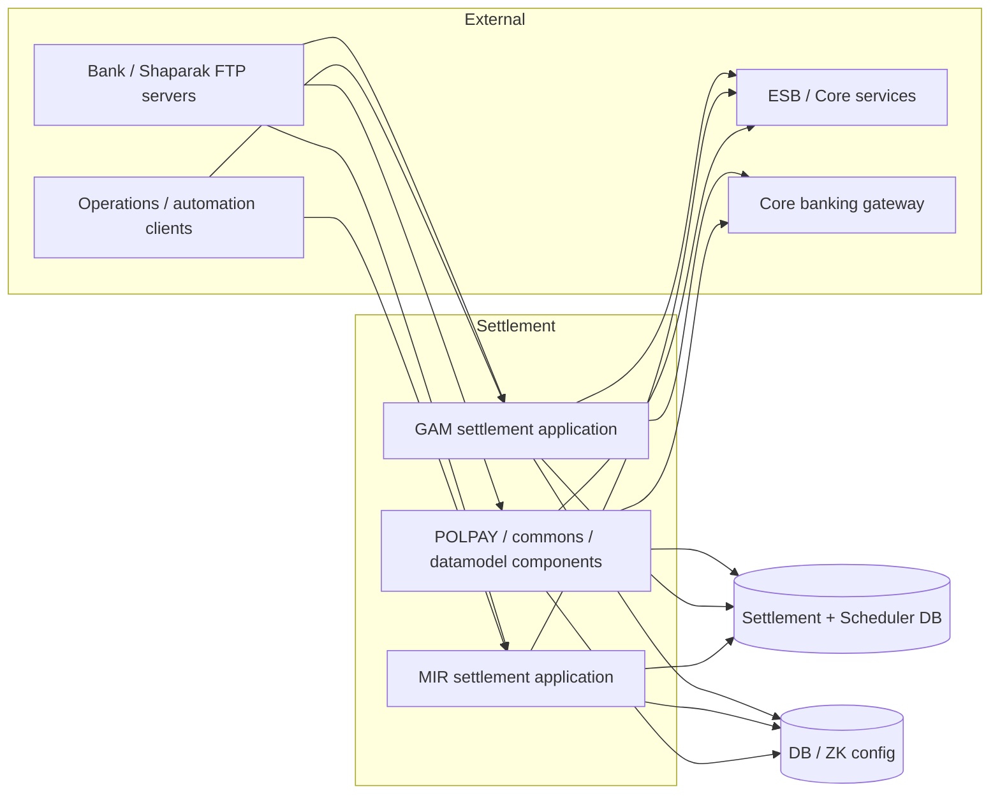
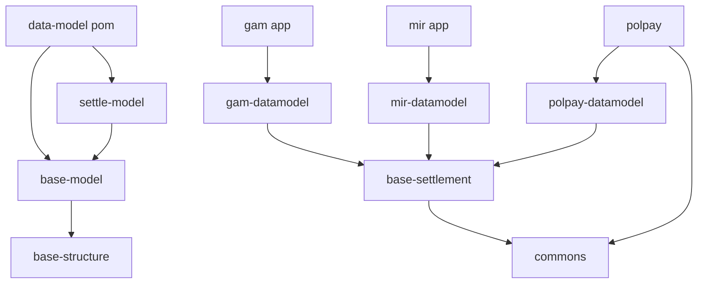
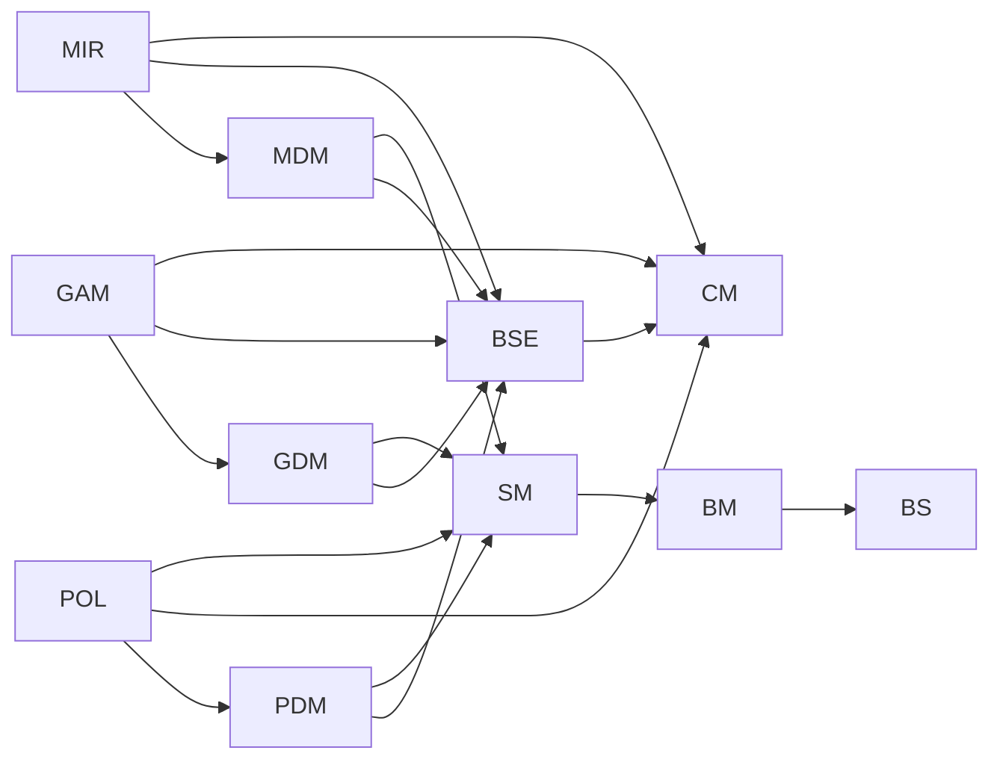
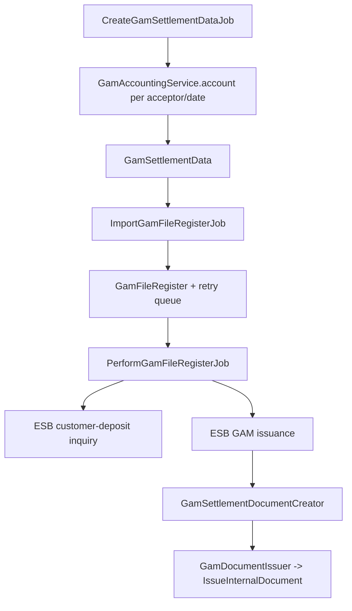

# Settlement Architecture Documentation (As-Is)

> Scope: Maven multi-module settlement code under `settle/` (excluding `pertrx`) plus its sibling base projects `base-structure` and `settle-panneldatamodel` under `E:\project\dotin\PTS`. The `pertrx` module was intentionally ignored for this task. Statements below were derived from source inspection and the generated Graphify report in `graphify-out/`.

---

## 1. Overview

The repository implements a **batch-oriented, Quartz-scheduled settlement system** for bank/PSP settlement file processing. It is a Maven multi-module Java 21 / Spring Boot 3.2-3.3 project. The observable runtime style is a **modular monolith with layered internals**, not a distributed microservice or event-driven architecture:

- There are two `@SpringBootApplication` entry points found in the selected modules: `GamSettlementApplication` and `MirSettlementApplication`.
- No Kafka/JMS/event-bus listeners were found in the selected modules.
- The only REST entry points found in the selected modules are a job-trigger controller and an integration-profile test controller.
- Most processing is triggered by Quartz jobs whose schedule metadata is stored in DB tables (`scheduler_job`, `scheduler_job_history`, `job_execution_history`), not hard-coded cron in the modules.
- Files are exchanged over FTP; transaction records are parsed, validated and persisted; accounting jobs aggregate transactions into `*SettlementData`; document-creation/issuance jobs build and issue documents to an external ESB/core backend; failed issuances go into retry queues.

The codebase is a set of libraries/components shared by one or more deployable Spring Boot applications:

| Layer | Observed evidence |
|---|---|
| Scheduling | Quartz `Job` base class in `settle/commons`; jobs extend it and record history |
| File intake | `FtpFileGetterService` / `FtpTransferService` / `BaseFileProcessor` |
| Parsing/validation | OpenCSV-based parsers (`OpenCsvFileParser`) and XML parsers (`XmlBaseParser`) with validator components |
| Domain/data model | JPA entities and DTOs in `settle-panneldatamodel` and each `*-datamodel` |
| Business services | `@Service` / `@Component` services in `gam`, `mir`, `polpay` |
| Issuance | `DocumentCreator` / `DocumentIssuer` abstractions in `base-settlement`/`commons` |
| Generic CRUD/mapping infrastructure | `base-structure` (`AbstractGeneralService`, `GeneralMapper`, criteria, serializers) |

---

## 2. System Context

The settlement applications depend on:

- **Counterparties / Shaparak** that deliver transaction or decline files over FTP.
- **A database** containing JPA entities plus scheduler/job metadata; bootstrap configs reference Oracle primarily, with H2 and PostgreSQL profiles available.
- **An ESB/core interface** for account/customer inquiries and internal document issuance (template classes such as `ESBGamCustomerDepositInfoTemplate`, `ESBMirCustomerCardInfoTemplate`, `IssueInternalDocumentTemplate`).
- **A core banking gateway** used through `CoreGatewayWrapper` (document request generation, issue, reverse, switch-topic settlement).
- **An operator API** (`/job/trigger`) for ad-hoc job execution.
- **External config sources** (DB-backed Spring Cloud Config and Zookeeper descriptor) via bootstrap configuration.

---

## 3. Architecture Style

Evidence from the source indicates a **layered architecture inside a modular-monolith build**:

- **Presentation/trigger layer:** thin `@RestController`s (`JobController`, integration-only `AutomationTestController`).
- **Scheduling/application layer:** Quartz jobs (`*Job extends Job`).
- **Service layer:** `@Service`/`@Component` services with `TransactionTemplate` or `@Transactional`.
- **Persistence layer:** Spring Data JPA repositories (`BaseRepository`, domain repositories).
- **Domain model:** JPA entities and DTOs. Mappers (MapStruct + `GeneralMapper`) convert DTO <-> entity.
- **Shared framework:** `base-structure` and `base-model` provide generic entity/DTO/service/mapping/criteria/serialization helpers reused across modules.

There is no evidence in the selected source of hexagonal, clean-architecture, CQRS, event-sourcing, or microservice patterns. The code uses interface abstractions for processors/validators/issuers (`BaseFileProcessor`, `CSVRowValidator`, `SimpleValidator`, `DocumentCreator`, `DocumentIssuer`), but the overall structure is a conventional layered Spring/Quartz application with heavy shared data-model modules.

---

## 4. Project Structure

The relevant source trees and approximate Java file counts (excluding `target` and generated Maven archetype files) are:

| Module | Location | Java files (approx.) | Role |
|---|---|---:|---|
| `base-structure` | `PTS/base-structure` | 161 | Generic framework: `bcpts` entities/DTOs/services/struct/mapping, criteria, serializers, reports, config |
| `data-model` | `PTS/settle-panneldatamodel` | pom aggregator | Parent POM for base-model and settle-model |
| `base-model` | `PTS/settle-panneldatamodel/base-model` | 113 | Base JPA model, scheduler/job entities, FTP config objects, annotations (`@Config`), utilities |
| `settle-model` | `PTS/settle-panneldatamodel/settle-model` | 556 | Large settlement domain model: batch/aggregate/fee/facility/shop/monitoring entities, DTOs, repositories/services, mappers |
| `commons` | `settle/commons` | 41 | Runtime infrastructure: Quartz job base, scheduler config, FTP transfer/getter helpers, dynamic config, core gateway wrappers |
| `base-settlement` | `settle/base-settlement` | 10 | Settlement primitives: `SettlementData`, `CurrencyAmount`, `DocumentCreator`/`DocumentIssuer`, settlement document repository/service |
| `gam-datamodel` | `settle/gam-datamodel` | 84 | GAM entities/DTOs/mappers/enumerations/repositories/services |
| `gam` | `settle/gam` | 52 | GAM application/jobs/controllers/services and parsers |
| `mir-datamodel` | `settle/mir-datamodel` | 23 | MIR fee-decline entities/DTOs/repositories |
| `mir` | `settle/mir` | 16 | MIR application/jobs/services/parsers |
| `polpay-datamodel` | `settle/polpay-datamodel` | 55 | POLPAY BNP/statement entities/DTOs/mappers/repositories |
| `polpay` | `settle/polpay` | 71 | POLPAY BNP/statement processors, validators, fee calculators, jobs, document creators |

---

## 5. Components / Modules

### 5.1 `base-structure` — shared generic framework

- Generic abstractions: `GeneralEntity`, `GeneralDto`, `GeneralService`, `AbstractGeneralService`, `AbstractBaseService`, `BaseRepository`, `GeneralMapper`, `DtoMapper`/`MappingManager`, `CycleAvoidingMappingContext`.
- Generic criteria/specification helpers under `bcpts/criteria`.
- JPA/Javers audit configuration (`JpaBaseConfig`, JaVers dependency), serializers/deserializers, date/calendar helpers, Jasper/DynamicJasper reporting helpers.
- Annotation `MPProfile` used to mark mapper profiles.

### 5.2 `settle-panneldatamodel` — data-model aggregator

- `base-model`: general infrastructure entities (`app_config`, `ftp_file`, `file_data`, `scheduler_job`, `job_execution_history`, etc.), `@Config`/`DynamicConfigService`, `FtpDescriptor`, `FTPServersConfigs`, scheduler services.
- `settle-model`: the settlement domain model (`batch`, `aggregate`, `fee`, `facility`, `shop`, `monitoring`, `identified`, `geo`, `core` packages), plus a large set of DTOs, mappers (`struct/mp/...`), repositories and services. This module is the biggest data-model dependency and contains much of the domain vocabulary used by `gam`, `mir`, and `polpay`.

### 5.3 `commons` — shared runtime plumbing

- `Job` base class for Quartz jobs: DB-backed enabled flag, dependent-job lock, history recording, dynamic config reload/prepare hooks.
- Quartz scheduler config and `SchedulerService`.
- `CommonsConfiguration`: Jackson `ObjectMapper`, refreshable `LegacyContextRefresher`, `LockRegistry`.
- `FtpFileGetterService` / `FtpTransferService`, CSV/OpenCSV parsing support, `FileUtil`, thread/time utilities.
- `JobController` exposing `/job/trigger`.
- Core gateway wrappers and settlement-spec resolver utilities.

### 5.4 `base-settlement` — settlement primitives

- `SettlementData` (abstract `@Entity`, TABLE_PER_CLASS) and `CurrencyAmount`.
- `DocumentCreator` / `DocumentIssuer` abstractions for issuance documents.
- `BaseSettlementDocument` repository/service and document issuance helpers.

### 5.5 `gam-datamodel` + `gam` — GAM settlement engine

Responsibilities found in source:
- Daily/PSP GAM transaction file ingestion (`GamFileParser`, `GamIssuerJob`, `GamDailyFile`, `GamTrx`).
- GAM shop-file processing (`GamShopFileParser`, shop jobs, `TransferGamShopTransactionsJob`).
- GAM SHAP and BSHAP disagreement file processing (FTP getter, import, perform jobs/services).
- Accounting aggregation: `CreateGamSettlementDataJob` -> `GamAccountingService.account()` -> `GamSettlementData`.
- File-register issuance: `ImportGamFileRegisterService`, `PerformGamFileRegisterService`, `GamFileRegisterJobItem`, then `GamSettlementDocumentCreator` / `GamDocumentIssuer`.
- Integration-test controller only active with `integration` profile.

### 5.6 `mir-datamodel` + `mir` — MIR Shetab fee decline engine

- FTP retrieval of Mir Shetab fee-decline files (`MirFeeFileFtpGetterJob`).
- CSV parse/import (`MirShetabFeeFileParser`, `MirShetabFeeFileImportService`) into `MirFeeDeclineTransaction`.
- Fee classification from config (`customer-to-bank`, `bank-to-bank`, `without-fee`).
- Document issuance and retry (`MirFeeIssuerJob`, `MirShetabFeeIssuerService`, `MirRetryIssueJob`, `MirShetabFeeRetryIssueService`).

### 5.7 `polpay-datamodel` + `polpay` — POLPAY BNP & statement settlement

- **BNP flow:** `BnpFileProcessor` (XML), `BnpTransaction`, `BnpSettlementData`, `BnpSettlementDocument`, `BnpAccountService`, `BnpSettlementJob`, BI sync.
- **Statement (STM) flow:** `StmtFileParser`/`StmtFileProcessor` (XML), `StmtTransaction`, `PolPayStmtSettlementData`, `StmtSettlementDocument`, fee calculators, `StmtAccountService`, `StmtSettlementJob`, BI sync.
- `polpay` has Spring `@Component`/`@Service`/job classes but **no `@SpringBootApplication`** in the selected source. Its deployment/packaging is not verifiable from this code and is listed under Unknowns.

### 5.8 Applications

- `GamSettlementApplication` (package `ir.dotin.settlement.gam`) — `@SpringBootApplication`, `@EnableConfigServer`, `@EnableEncryptableProperties`, `@EnableCaching`, scans `ir.dotin`, entity-scan includes `bcpts`, `gam`, `entity`.
- `MirSettlementApplication` (package `ir.dotin`) — same style, excludes Spring Security auto-configuration, no explicit entity-scan list found in the class header.

Both exclude Spring Security auto-configuration classes.

---

## 6. Dependency Map

Verifiable Maven dependencies:

- `payment-settlement` parent (`settle/pom.xml`) declares modules and common dependencies; it also depends on `ir.dotin:base-model`, `ir.dotin:general-service`, Fanap `coregateway`, Spring Cloud/Quartz/Web/JPA/Jasper/OpenCSV/MapStruct, etc.
- `base-settlement` -> `commons`.
- `gam-datamodel` -> `base-settlement`.
- `gam` -> `gam-datamodel`.
- `mir-datamodel` -> `base-settlement`.
- `mir` -> `mir-datamodel`.
- `polpay-datamodel` -> `base-settlement`.
- `polpay` -> `polpay-datamodel` + `commons`.
- `base-model` -> `base-structure`.
- `settle-model` -> `base-model`.

Code-level (not only POM) coupling is heavier: settlement domain DTOs in `settle-model` reference `GeneralDto`/`CurrencyAmount`/`GeneralEntity` from the shared framework; GAM/MIR/POLPAY service code imports `ir.dotin.settlement.*` base services and `ir.dotin.esb.*` integration templates.

Note: The POM graph does not express every runtime class dependency; for example domain classes from `settle-model` are used by all three domain engines, and shared primitives (`CurrencyAmount`, settlement-spec utilities) are reused across modules.

---

## 7. Data Flow

### 7.1 Common file-processing pipeline

The selected modules share a repeated pattern:

```mermaid
flowchart LR
    FTP[FTP source] -->|download| FD[FileData / local file]
    FD --> DAF[Daily file entity / FTPFile]
    DAF --> PARSE[Parser + validators]
    PARSE --> TXN[Transaction entity rows]
    TXN --> ACCT[Accounting job]
    ACCT --> SD[SettlementData row]
    SD --> DOC[DocumentCreator]
    DOC --> ISSUE[DocumentIssuer / ESB core call]
    ISSUE --> RETRY[(retry queues / failure docs)]
```

Observed implementations:

- FTP download writes file bytes to `file_data` and creates an `ftp_file`/daily-file row.
- Parsers use row validators and build success/failed file artifacts (`file_data` plus counts on the daily file).
- Transactions are saved in batches with `TransactionTemplate`.
- Accounting services aggregate `*Transaction`s into domain-specific `*SettlementData` (`GamSettlementData`, `BnpSettlementData`, `PolPayStmtSettlementData`).
- Settlement jobs create `*SettlementDocument`s and issue them through `DocumentIssuer`; documents with failures stay in retry queues until max retry count.

### 7.2 GAM document-issuance flow

---

## 8. Main Business Flows

### 8.1 GAM daily/PSP file ingestion and accounting

1. `GamIssuerJob` ensures a `GamDailyFile`, downloads the daily file from the configured GAM FTP descriptor, and runs `GamFileParser.transfer(...)`.
2. `GamFileParser` parses rows with OpenCSV, validates via injected `CSVRowValidator`s, detects duplicates by `bigId`, saves `GamTrx`, and persists success/failed file contents.
3. `CreateGamSettlementDataJob` iterates working dates up to a guaranty window and calls `GamAccountingService` per acceptor.
4. `GamAccountingService` loads/creates `GamSettlementData`, accumulates transactions into it, updates statuses, and saves transactions with settlement references.

### 8.2 GAM file-register and document issuance

1. `ImportGamFileRegisterJob` finds `GamSettlementData` rows in `CREATING` status.
2. `ImportGamFileRegisterService` rounds the total amount (configurable up/down and multiple), creates `GamFileRegister`, sets status to `IN_QUEUE_CUSTOMER_DEPOSIT_INFO`, and adds it to retry queue.
3. `PerformGamFileRegisterJob` processes queue items: deposit-info inquiry via `ESBGamCustomerDepositInfoTemplate`, then GAM issuance via `ESBGamIssuanceTemplate`; failures increment retry counts.
4. `GamSettlementDocuementIssuanceJob` creates the settlement document through `GamSettlementDocumentCreator` and issues it through `GamDocumentIssuer` (only when enabled by config).

### 8.3 GAM shop and disagreement flows

- Shop files: `GamShopFileFtpGetterJob` / `ImportGamShopFileJob` / `TransferGamShopTransactionsJob` parse and transfer `gam_shop_file` / `gam_shop_trx`.
- Disagreement files: separate `shap` and `bshap` FTP-getter, import, and perform jobs/services (`ImportGamShapDisagreementFileService`, `PerformGamShapDisagreementFileTrxService`, etc.).

### 8.4 MIR Shetab fee-decline flow

1. `MirFeeFileFtpGetterJob` downloads files for a date and creates `MirFeeDeclineDailyFile` rows.
2. `MirFeeImportJob` calls `MirShetabFeeFileImportService.importTrx`, which parses/validates the file and persists `MirFeeDeclineTransaction` rows with fee/status classification.
3. `MirFeeIssuerJob` calls `MirShetabFeeIssuerService.process` for transactions; normal and customer-to-bank issuance go through ESB templates.
4. `MirRetryIssueJob` retries failed docs, either re-sending an empty-document request or replaying stored `documentJSON`.

### 8.5 POLPAY BNP flow

1. `BnpFileProcessorJob` runs `BnpFileProcessor.process(date)`: download/transfer XML files from FTP into `BnpDailyFile`, parse XML records, map to `BnpTransaction`, save daily files and transactions.
2. `BnpAccountJob` calls `BnpAccountService.account(date)`: finds accountable transactions and writes `BnpSettlementData` with credit/debit amounts, fees, counts.
3. `BnpSettlementJob` creates/issue `BnpSettlementDocument`s from unsettled settlement data.
4. `BnpSyncBiJob` syncs BI rows using `SyncBiService` over `NamedParameterJdbcTemplate`.

### 8.6 POLPAY statement (STM) flow

1. `StmtFileProcessorJob` runs `StmtFileProcessor.process(date)`: downloads/transfers statement XML, parses records, applies fee calculators, maps to `StmtTransaction`.
2. `StmtAccountJob` calls `StmtAccountService.account(date)`: groups transactions by IBAN/creditor-debtor key, creates or updates `PolPayStmtSettlementData`.
3. `StmtSettlementJob` selects a `DocumentCreator` by `support(settlementData)` and creates/issue `StmtSettlementDocument`s.
4. `StmtSyncBiJob` syncs BI rows.

---

## 9. API / External Integrations

### 9.1 REST endpoints found in selected modules

| Endpoint | Module/class | Notes |
|---|---|---|
| `POST /job/trigger` | `commons` `JobController` | Accepts `SchedulerJobDto`; updates configs and triggers a Quartz job |
| `POST /automation-test/change-system-time/{offset}` | `gam` `AutomationTestController` | `integration` profile only |
| `POST /automation-test/change-system-fixed-time/{fixed-time}` | `gam` `AutomationTestController` | `integration` profile only |

No other REST controllers were found in `gam`, `mir`, `polpay`, `commons`, `base-settlement`, `base-structure`, or the pannel data-model modules in the selected scope.

### 9.2 ESB / core integrations

- `ir.dotin.esb.message.*` template classes are used by GAM and MIR services, e.g.:
  - `ESBGamCustomerDepositInfoTemplate`, `ESBGamIssuanceTemplate`
  - `ESBMirCustomerCardInfoTemplate`, `ESBMirIssuanceTemplate`, `ESBMirCustomerIssuanceTemplate`
  - `IssueInternalDocumentTemplate` (used by `DocumentIssuer`)
- `CoreGatewayWrapper` wraps Fanap `CoreGateway` (decompiled source comment present) for document requests, issue/reverse, switch-topic settlement, and balance operations.
- Actual ESB/core URLs, credentials, timeouts and circuit-breaker settings are not in the selected source tree; they come from config.

### 9.3 FTP integration

- `FtpDescriptor`/`FTPServersConfigs` define per-bank FTP descriptors.
- GAM defines descriptors for GAM, shop, SHAP disagreement and BSHAP disagreement.
- MIR defines a Shetab-fee descriptor.
- `FtpTransferService` performs downloads; downloaded bytes are stored in `file_data`.
- POLPAY processors use FTP getter services plus a configurable base path for local files.

---

## 10. Database Architecture

- Persistence is JPA/Hibernate with Spring Data repositories. `BaseRepository` extends `CrudRepository`, `JpaSpecificationExecutor`, and `PagingAndSortingRepository`.
- The observed `@Table` names across the selected model modules include more than 100 tables, covering: `file_data`, `ftp_file`, `scheduler_job*`, `job_execution_history`, `gam_*`, `mir_*`, `bnp_*`, `stmt_*`, `batch_*`, `aggregate_settle_*`, `fee_*`, `facility_*`, `shop*`, `app_config`, and monitoring/audit tables.
- `SettlementData` uses `@Inheritance(strategy = InheritanceType.TABLE_PER_CLASS)`; concrete subclasses each map to their own table and inherit id/version/modifiedDate semantics.
- Inheritance roots `GeneralEntity` / `GeneralDto` standardize id handling, and mapping infrastructure (`GeneralMapper`, `DtoMapper`, `MappingManager`) supports DTO<->entity conversion.
- `BCPDataSource` (Hikari subclass) enriches Oracle connections with session/module/client-info and query-deadline metadata.
- `@EnableJpaAuditing` and JaVers are configured in `base-structure`; `SettlementData.modifiedDate` is `@LastModifiedDate` and version fields are used for optimistic locking.
- Actual DDL/migrations are not present as application-managed Flyway scripts inside the selected modules (Flyway dependencies exist in the data-model parent but the bootstrap files disable Flyway: `spring.flyway.enabled: false`). SQL/DDL content appears in `settle-panneldatamodel/must-be-done.txt` release notes. Schema management should be treated as external/unknown.

---

## 11. Configuration & Infrastructure

### 11.1 Spring profiles / data sources

- `gam` and `mir` ship `bootstrap.yml` variants for Oracle/H2 (`integration`) and PostgreSQL profiles, plus Zookeeper client config.
- Example bootstrap settings reference Spring Cloud Config, an Oracle data source, and Jasypt encryption (`PBEWITHHMACSHA256ANDAES_128`).
- Actual production credentials/URLs are not in these files and are expected to come from config-server/DB/ZK.

### 11.2 Runtime config patterns

- `@Config("key:default")` fields are injected as `Supplier<T>` and can be reloaded (dynamic config service).
- `CommonsConfiguration` registers a primary `ObjectMapper`, refreshable config handling, and lock registry.
- `base-structure`/`base-model` add Caffeine cache manager and Resilience4j circuit-breaker configuration.

### 11.3 Scheduling

- Jobs are Quartz `JobBean`s registered as Spring components.
- Execution looks up `SchedulerJob` by name/group; disabled jobs are skipped.
- Optional named locks (`LockRegistry`) prevent dependent jobs from running concurrently.
- Every run writes `SchedulerJobHistory` and `JobExecutionHistory`.
- The scheduler starts job groups from `app.quartz.job-groups` (default `settle`).
- Exact cron expressions and enabled flags were not found in source and are expected to live in DB (`scheduler_job`) / external config. This is listed under Unknowns.

---

## 12. Error Handling

- Job failures are captured by the `Job` base class: history rows transition to `FAILED`, exceptions are logged, and the scheduler record remains for later runs.
- File-processing failures are recorded per file/row: daily files carry `totalCount`, `successCount`, `failedCount`, plus success/failed file artifacts.
- Issuance uses retry queues and state machines:
  - `DocumentIssuer` checks max retry, deserializes stored document XML/JSON, calls ESB, and moves documents to done or retry/failed states.
  - MIR stores failed-document JSON and retries it (`MirShetabFeeRetryIssueService`).
  - GAM stores `GamFileRegisterJobItem` retry rows with status transitions.
- Business/validation failures are signaled with exceptions such as `BusinessException`, `CSVParseException`, and validator results.
- No global `@ControllerAdvice` exception handler was found in the selected modules.

---

## 13. Authentication / Authorization

- Spring Security starters exist in shared dependencies and `base-structure` uses `SpringSecurityAuditorAware`, but both `GamSettlementApplication` and `MirSettlementApplication` exclude `SecurityAutoConfiguration` and `ManagementWebSecurityAutoConfiguration`.
- No security filters, `UserDetailsService`, JWT, OAuth, or authorization rules were found in the selected application modules.
- The only general-purpose REST endpoint (`/job/trigger`) is unguarded in the selected source; the automation-test controller is gated by the `integration` profile.
- Effective runtime exposure/security of these apps is not verifiable from the repository. Marked **Unknown / Needs Investigation**.

---

## 14. Observability / Logging

- Logging is Log4j2-based (`org.apache.logging.log4j`); root POM replaces Spring Boot default logging with `spring-boot-starter-log4j2`.
- Spring Boot Actuator dependency is declared, but no actuator configuration/custom endpoints were found in the selected modules.
- Job execution is observable through DB history tables (`scheduler_job_history`, `job_execution_history`) and domain status/process-status fields.
- `BCPDataSource` writes Oracle session/module/client-info and logs SID/instance for each transaction.
- JaVers and JPA auditing are present for audit/history of entities.
- No tracing/APM/metric exporters or structured observability configuration were found in the selected source.

---

## 15. Architecture Risks & Technical Debt

- **Large shared data model:** `settle-model` contains 500+ Java files spanning many bounded areas (batch, aggregate, fee, facility, shop, monitoring, geo, core). This makes module ownership and change impact hard to reason about.
- **Duplicate foundational types:** `CurrencyAmount` exists in `base-structure` (`ir.dotin.bcpts.entity`), `base-model` (`ir.dotin.entity`), and `base-settlement` (`ir.dotin.settlement.entity`); `BusinessException` also exists in multiple modules. Duplication creates ambiguity and conversion risk.
- **No deployable entry point for `polpay`:** `polpay` is a library of jobs/services; deployment packaging and which host application runs it is unknown from the selected source.
- **Configuration externalized beyond source:** actual job schedules, FTP descriptors, ESB endpoints, credentials, and environment profiles live outside the source tree, making local reproduction difficult and observability of configuration harder.
- **No real automated tests found:** the only `src/test` Java files under the selected modules are Maven archetype placeholders under `resources/archetype-resources`; there are no executable unit/integration test sources in the actual module trees.
- **Decompiled source:** `CoreGatewayWrapper` contains a "Source code recreated from a .class file" header, meaning part of the integration layer is reconstructed and less maintainable.
- **Generic CRUD abstraction risk:** `AbstractGeneralService`/generic mappers centralize entity/DTO operations; without domain guards this can bypass business invariants if not carefully controlled by subclasses.
- **Unclear security posture:** both applications disable Spring Security auto-configuration, while exposing at least one unauthenticated-looking trigger endpoint in source.
- **Batch time semantics:** code uses Joda `DateTime`, Persian calendar utilities, fixed time-mocking endpoints (`AutomationTestController`), and accounting windows driven by `JobExecutionHistory.lastExecutionDateTime`; date rollover and time-zone correctness are critical and non-obvious.

---

## 16. Open Questions / Unknowns

The following could not be verified from the selected source and are marked **Unknown / Needs Investigation**:

- Actual deployment topology for `polpay`, `gam`, and `mir` (single process vs. multiple applications; which process loads which modules).
- Exact Quartz cron expressions, job groups, and enabled states (expected in `scheduler_job` DB rows).
- Production database vendor/schema, DDL ownership, and migration process (Oracle is strongly indicated by bootstrap/config and SQL release notes; Flyway is disabled in app bootstrap files).
- Production FTP server descriptors, directory layouts, and file naming rules beyond the configurable pattern placeholders.
- ESB/core endpoint URLs, credentials, timeouts, TLS, and circuit-breaker tuning.
- Runtime authentication/authorization (security auto-configuration is disabled in GAM/MIR source).
- Log aggregation, monitoring, alerting, and tracing stack in production.
- File-format specifications for GAM daily/shop/disagreement files, MIR Shetab fee files, and POLPAY BNP/statement XML files.
- Whether `settle-managementpannel` or other sibling projects consume these modules; they were outside this task's inspected scope.
